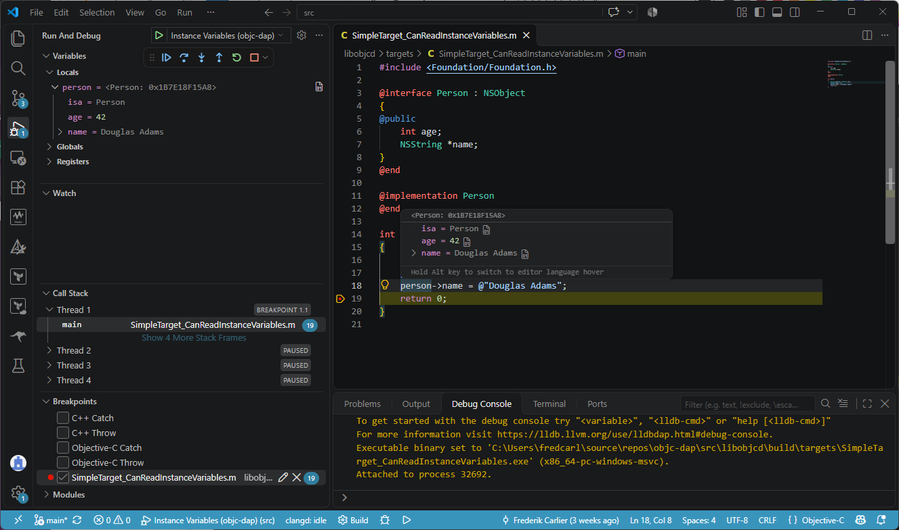

# Objective-C Debug Adapter for Windows and Linux

This Objective-C Debug Adapter for Windows and Linux provides a better debugging experience when building Objective-C applications using the libobjc2 runtime on Windows and Linux.



## Getting Started

The Objective-C Debug Adapter assumes you are using [libobjc2](https://github.com/gnustep/libobjc2) as the Objective-C runtime (using the non-fragile ABI), [GNUstep](https://www.gnustep.org/) as the base library and [Clang](https://github.com/llvm/llvm-project/) as the compiler.  The [conan-gnustep](https://github.com/qmfrederik/conan-gnustep) project provides you with prebuilt binaries for Windows and Linux.

The [tutorial project](https://github.com/qmfrederik/conan-gnustep/tree/main/tutorial) can help you get started building an Objective-C application on Windows or Linux, using [Conan](https://conan.io/) and [CMake](https://cmake.org/).

[VS Code](https://code.visualstudio.com/) brings a modern Objective-C editing experience on Windows and Linux.  You can use [clangd](https://github.com/clangd/vscode-clangd) for Objective-C code completion, syntax highlighting and more.

### Download objc-dap
To download and install objc-dap:

1. Install the latest version of LLDB (part of LLVM on Windows).
2. On Windows, download and install Python.  LLDB has a dependency on Python, but does not ship Python.  On Linux, your package manager takes care of this.
3. Download the [latest version of the Objective-C Debug Adapter from GitHub releases](https://github.com/qmfrederik/objc-dap/releases/latest).
4. Extract `objc-dap` (or `objc-dap.exe`) to a root of your Objective-C's application workspace.

`objc-dap` has a dependency on `lldb-dap`.  It will try to find `lldb-dap` in common locations.  You can run `objc-dap tool-version` to check where it found lldb-dap and, on Windows, Python:

```console
$ objc-dap tool-version
lldb-dap.exe: C:\Program Files\LLVM\bin\lldb-dap.exe (23.1.3)
python3.dll: C:\Users\username\AppData\Local\Python\pythoncore-3.15-64\python3.dll (3.15.150.1013)
```

### Configure your VS Code project

1. Install [VS Code](https://code.visualstudio.com/) and the [LLDB DAP](https://marketplace.visualstudio.com/items?itemName=llvm-vs-code-extensions.lldb-dap) extension.
2. Create a `launch.json` configuration for your Objective-C application.  In your `launch.json` configuration, set `debugAdapterExecutable` to the path of the extracted `objc-dap` binary:

```json
{
    "version": "0.2.0",
    "configurations": [
        {
            "name": "My Application (objc-dap)",
            "type": "lldb-dap",
            "request": "launch",
            "program": "${workspaceFolder}/build/myapp",
            "debugAdapterExecutable": "${workspaceFolder}/objc-dap",
            "windows": {
                "program": "${workspaceFolder}/build/myapp.exe",
                "debugAdapterExecutable": "${workspaceFolder}/objc-dap.exe"
            }
        },
    ]
}
```

All set!  You can now run and debug your Objective-C application.

## How it works

`lldb-dap` does not understand the non-fragile (GNUstep) Objective-C ABI.  The Objective-C Debug Adapter acts as a proxy for `lldb-dap`, and intercepts specific requests, such as variable requests.  It inspects the debuggee (your application)'s memory to provide more detail about Objective-C objects.
